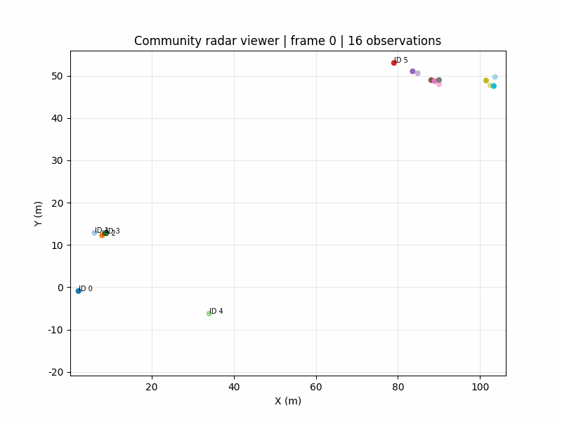
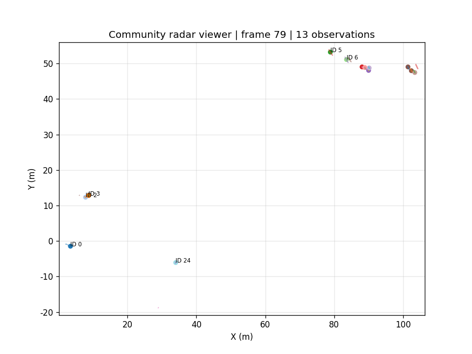

# a100-radar-viewer-enhanced

由 [Aias00](https://github.com/Aias00) 自主维护的 **Community Project**，并非 SuperRadar 官方工具。基于 CTSAI-A100 仓库公开的 Python 雷达可视化示例，提供增强的离线数据回放、目标跟踪和回归测试。适合开发者检查采集日志、调试帧顺序与跟踪状态；无需连接雷达即可运行随附 Demo。

项目完整承接 [PR #137](https://github.com/Super-Radar/CTSAI-A100/pull/137) 的八项修复，按照[维护者建议](https://github.com/Super-Radar/CTSAI-A100/pull/137#issuecomment-6311943711)独立项目化。代码、测试、公开样例和结果全部在此目录内；可单独复制此目录运行。

## 相较于官方基础示例的改进

| 场景 | 本项目行为 | 回归追溯 |
| --- | --- | --- |
| 新目标与旧目标混排 | 跟踪 ID 按观测行写回，避免身份错位 | #103 / #104 |
| 空帧、重绘、跳帧 | 空帧推进丢失计数；同帧重绘复用结果；跳帧重置状态 | #105 / #106 |
| 坏距离、速度、角度或目标编号 | 先验证测量再填默认值，丢弃无效测量 | #111 / #112 |
| 设备帧号重复、回绕或缺失 | 用文件内序号回放，另存原始设备 FrameNb | #117 / #118 |
| 文件末尾缺少 END | 保留末帧并标记未闭合 | #119 / #120 |
| 距离颜色条失效 | 绑定当前散点；空帧和聚类模式隐藏 | #121 / #122 |
| 采集间隔不均匀 | 采集时间驱动 Kalman F/Q；无效时间回退 0.1 秒；重复/倒退时间重置运动状态 | #123 / #124 |
| 匹配门限与全局分配冲突 | 门限在分配前生效，允许未匹配，优先最大化有效匹配数量 | #127 / #128 |

这些改进限于本项目副本，不改变官方基础示例。其他贡献者的 #89 不由本项目替代。

## 环境与运行

使用 CTSAI-A100 仓库公开的目标点云日志，无需固件、RadarTools 或硬件连接。已在 macOS、Python 3.9.6、NumPy 2.0.2、pandas 2.3.3、SciPy 1.13.1、Matplotlib 3.9.4、scikit-learn 1.6.1 上完成以下测试与无窗口 Demo。推荐 Python 3.10–3.12，需带 tkinter 的 Python；Linux 通常需系统安装 `python3-tk`。交互 GUI 需要桌面显示环境。

从本目录执行：

```sh
python -m venv .venv
# Windows 使用 .venv\Scripts\activate
source .venv/bin/activate
python -m pip install -r requirements.txt
python radarViewer.py
```

在打开文件对话框选择 `data/sample.csv`。界面提供播放/暂停、逐帧、速度、跳帧、筛选、跟踪、聚类和轨迹设置。显示的回放帧序号从 0 开始；目标表 FrameNb 保留设备帧号。

无窗口 Demo（仍需要安装 tkinter，但不创建 GUI 窗口）：

```sh
python demo.py
# 可替换数据、结果目录
python demo.py --data data/sample.csv --output figures
```

Demo 直接调用项目的 RadarParser 和 KalmanTracker，逐帧处理公开数据前 80 帧，再生成 10 fps 回放和第 79 帧轨迹图。GIF 是固定展示帧率，跟踪使用日志采集时间；它是离线算法展示，不是交互 GUI 截屏。





实测解析 2463 帧，Demo 输出 80 帧；第 79 帧有 13 个有效观测。轨迹是算法估计，并非标注真值；为避免遮挡只标注前六个观测的 ID。

## 回归验证

```sh
MPLBACKEND=Agg PYTHONDONTWRITEBYTECODE=1 python -m unittest discover -s tests -p 'test_*.py' -v
```

37 项测试通过，覆盖上表八项修复、组合解析/跟踪状态、真实公开样例 2463 帧兼容性。真实 NumPy / SciPy / pandas / Matplotlib Agg 参与测试；Tk 控件使用替身或 Tcl 变量。测试不需要仓库其他目录或硬件。没有完成交互式 GUI 或硬件采集验证，也未进行精度/性能基准评估。保留官方示例的已有格式和依赖限制，不宣称支持任意 CSV 表头或可选依赖降级。

## 来源、许可证与维护

- 上游：[Super-Radar/CTSAI-A100](https://github.com/Super-Radar/CTSAI-A100)，官方 `Python雷达可视化工具示例/radarViewer.py`，基础提交 `9a41e22b22b981d1500e4a28e056407baeb1027f`。
- 增强实现及测试：PR #137，提交 `0898083cc7b587d1ccbda11afe5686867af011de`。迁移时保留实现，补充文件修改声明，调整测试的样例路径；新增独立运行说明、Demo、公开数据副本及结果。
- 原始代码及本项目按 Apache-2.0 分发，完整许可证见 [LICENSE](LICENSE)，来源和修改说明见 [NOTICE](NOTICE)。未移除原文件已有说明。
- 数据出处、校验值与采集信息边界见 [data/README.md](data/README.md)。
- 社区维护者：[Aias00](https://github.com/Aias00)。问题与后续改进请明确指向本社区项目；维护和发布由开发者自行负责，不代表 SuperRadar 官方支持或背书。
